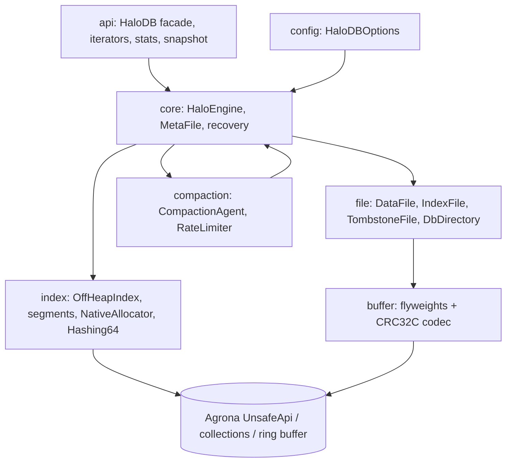
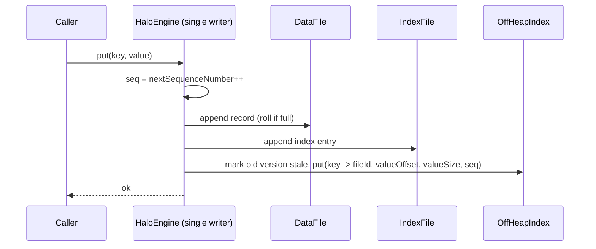
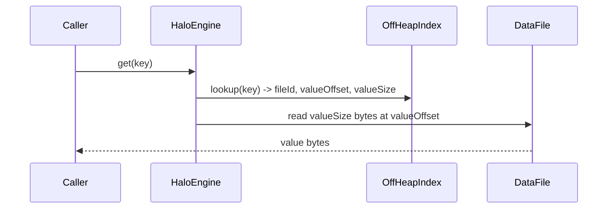
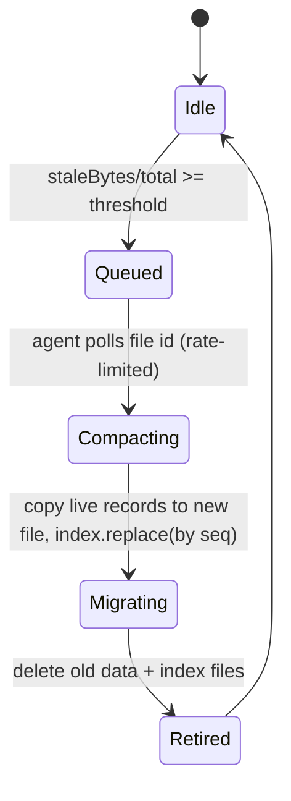

# halo-next Architecture

halo-next is an embedded, append-only key-value store: a JDK 21 port of HaloDB
built on the Agrona framework. All keys and their metadata live in an off-heap
index; values live in append-only log files on disk. A read costs one disk
seek (read amplification = 1).

## Module map

## On-disk format (Format v1)

All structures are little-endian with a leading CRC32C. See
docs/decisions/0002-on-disk-format.md.

- Data record (18-byte header): crc32c, version, keySize, valueSize,
  sequenceNumber, then key, then value.
- Index entry (22-byte header): crc32c, version, keySize, recordSize,
  recordOffset, sequenceNumber, then key.
- Tombstone (14-byte header): crc32c, version, sequenceNumber, keySize, then key.
- META (19 bytes): crc32c, version, open flag, sequenceNumber, io-error flag,
  maxFileSize.

Files are named `<id>.data`, `<id>.index`, `<id>.tombstone`, plus `META`.

## Write path

Writes are serialized by a single write lock. Records are appended sequentially;
rolled files become immutable.

## Read path

Reads do not take the write lock. The index segment spin-lock guards the lookup;
the value read is a single positional read. If a file is being retired by
compaction, `get` re-resolves through the index and retries.

## Compaction

A background Agrona `Agent` (on an `AgentRunner` with `BackoffIdleStrategy`)
drains a `ManyToOneRingBuffer` of file ids. Each file is rewritten out of place:
live records migrate to a separate compaction write file and the index is
updated with a sequence-number guard. Write amplification is approximately
`1 / compactionThresholdPerFile`.

## Recovery

On open the engine replays every index file (ascending) to rebuild the off-heap
index, then applies tombstones (a tombstone deletes a key only if no newer
record exists). The next sequence number and file id follow the maxima seen.
Torn or corrupt trailing entries are detected by CRC32C and stop replay for that
file. The META open flag distinguishes a clean shutdown from a crash.

## Concurrency model

- Single writer: all mutations serialized by one lock.
- Multi reader: readers resolve versions through sequence numbers; no write lock.
- Index: power-of-two segments (at least 2x CPUs), per-segment spin-lock.
- Compaction: one background agent thread; file-id allocation and the read-file
  array are guarded by a dedicated monitor; the index uses sequence-number
  guarded `replace`.
