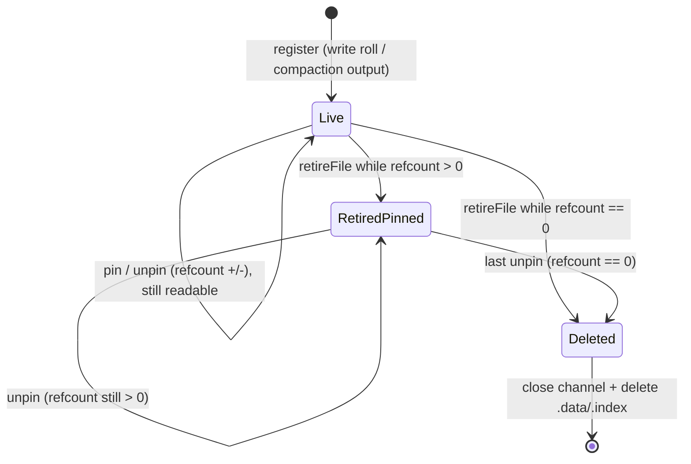
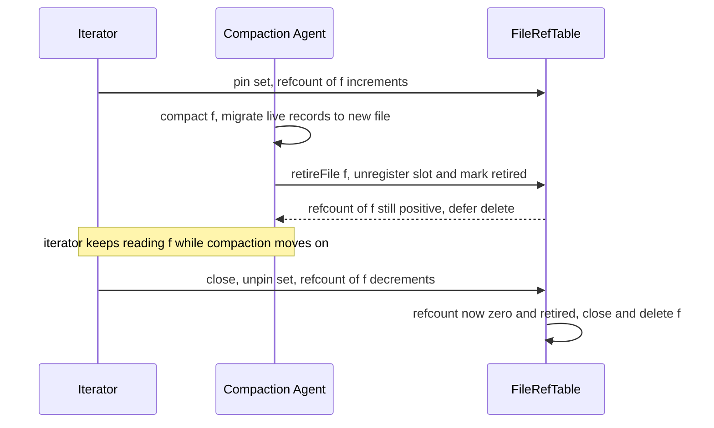

# ADR-0006: Version Pinning and File Reference Counting for Lock-Free Snapshots

- Status: Proposed
- Date: 2026-11-19
- Deciders: halo-next
- Supersedes (on acceptance): ADR-0005 for the snapshot/iterator consistency path

## Context

ADR-0005 made `snapshot()` and the record iterators correct by pausing compaction
for their whole duration (a reference-counted stop-the-world handshake; see the
amendment in ADR-0005). That is correct but blunt:

- While a snapshot is linking files, compaction is fully stopped. On a large
  database the link step plus any concurrent iterator lifetime is a window in
  which stale data accumulates and no reclamation happens.
- A long-lived `HaloDBIterator` holds the pause for its entire walk, so a reader
  that iterates slowly can starve compaction indefinitely.
- The pause couples two unrelated concerns: "an admin asked to stop background
  work" and "a reader needs a stable file set". Only the first truly needs to
  stop compaction.

The root cause is that `retireFile` deletes a data/index file eagerly the moment
compaction finishes migrating its live records:

```
// HaloEngine.retireFile (current)
unregisterReadFile(fileId);                 // null the readFiles slot
source.close();                             // close the FileChannel
Files.deleteIfExists(... dataFile(fileId));  // physical delete
Files.deleteIfExists(... indexFile(fileId));
```

Because deletion is eager, any reader that needs a file to stay alive across many
reads (an iterator walking it, or a snapshot linking it) can only be made safe by
preventing the retirement from happening at all, i.e. by pausing compaction.

Constraints and invariants that shape the fix:

- Hot path is sacred: `get` / `put` / `delete` and the index lookup MUST NOT gain
  a lock, an allocation, or extra atomic traffic. The existing lock-free `get`
  retry loop (re-resolve on `ClosedChannelException` / null slot) stays.
- Single-writer principle; cold admin paths (open, iterator lifecycle, snapshot,
  pause) may take locks and condition variables.
- Immutable rolled data files; append-only; sequence-number version resolution.
- Compaction runs on an Agrona `Agent` + `AgentRunner`.
- On-disk format is a contract; this ADR does not change it (no MANIFEST in v1).

This is the design used by LevelDB / RocksDB (VersionSet + refcounted table
files, deletion deferred until no iterator or snapshot references a version),
Cassandra (SSTable refcounting with hard-linked snapshots), and LMDB (deferred
page reclamation).

## Decision

Decouple logical retirement from physical deletion with per-file reference
counting, and let long-lived readers pin the file set they need instead of
pausing compaction.

1. Keep `readFiles` (the `volatile DataFile[]` indexed by fileId, copy-on-write)
   exactly as-is as the lock-free fast lookup for `get`. Logical retirement still
   nulls the slot so new `get` calls re-resolve to the migrated location.

2. Add a `FileRefTable` owned by the engine and guarded by the existing
   `fileMutex`. For every fileId it holds the `DataFile`, an `int` reference
   count, and a `retired` flag. It is the authority for a file's physical
   lifetime. All its operations are cold-path and short.

3. `retireFile` becomes: `unregisterReadFile(fileId)` (logical), then under
   `fileMutex` mark the file `retired`; if its refcount is already zero delete it
   now, otherwise defer. The last `unpin` that drops the count to zero on a
   `retired` file performs the physical close + delete.

4. A long-lived reader acquires a `PinnedVersion` (a `Closeable`): at
   construction it snapshots the current live fileId set and increments the
   refcount of each; `close()` decrements each exactly once. While pinned, those
   files cannot be physically deleted even though compaction may retire them
   logically and migrate their records elsewhere.

5. `RecordScanner` pins a `PinnedVersion` instead of calling `pauseCompaction()`.
   It still filters by `isLiveVersion` (sequence-number resolution), so records
   already migrated to newer files are skipped and each live key is returned once.
   Compaction runs concurrently.

6. `snapshot()` pins the current version, briefly takes the write lock only to
   flush the in-flight write / index / tombstone / compaction files for
   durability, then hard-links the pinned set while compaction keeps running.
   The pinned set is internally consistent: at pin time every index entry
   resolves to a file in the set, and pinned files are not deleted, so the linked
   image reopens cleanly under checksum-bounded, sequence-number-resolved replay.

7. `get` is unchanged and does NOT pin. A single `get` is bounded; if a file is
   deleted mid-read the existing `ClosedChannelException` / null-slot retry
   re-resolves the index to the record's new location. Pinning is only for
   readers whose correctness spans many reads (iterators, snapshots).

8. `pauseCompaction()` / `resumeCompaction()` remain, but only as the admin
   "stop all background work" primitive (as in RocksDB `PauseBackgroundWork`).
   They are no longer on the snapshot or iterator correctness path.

### File lifecycle



### Pin / retire ordering



Lock ordering stays acyclic: pin / unpin / retire take `fileMutex` only; the
brief durability flush in `snapshot` takes `writeLock` without holding
`fileMutex`. No new lock pair is introduced relative to today.

## Implementation Plan

Phased so each step is independently testable and keeps all CI gates green.

### Phase 1 - Plumbing (no behavior change)

- Add `FileRefTable` (new class in `core/`): `Int2ObjectHashMap<DataFile> files`,
  `Int2IntHashMap refCounts`, `IntHashSet retired`, all mutated under `fileMutex`.
  Methods: `register(fileId, file)`, `pin(int[] fileIds)`, `unpin(int[] fileIds)`
  returning the ids that became deletable, `retire(fileId)` returning whether to
  delete now.
- Route `registerReadFile` / `unregisterReadFile` through the table so it tracks
  the same lifecycle the `readFiles` array already models.
- Rework `retireFile` to consult the table and split out `physicallyDelete(fileId,
  DataFile)` (close channel, delete `.data` + `.index`, update
  `staleBytesPerFile` / `totalStaleBytes` under `writeLock`).
- No caller pins yet, so every file has refcount 0 and deletion stays eager:
  behavior identical to today. Run full `test integrationTest` to prove parity.

### Phase 2 - Pinned iterators

- Add `PinnedVersion implements Closeable`: constructor calls
  `engine.pinFileIds(snapshotFileIds())`; `close()` calls
  `engine.unpinFileIds(...)` exactly once (idempotent guard, as `RecordScanner`
  already guards `paused`).
- Replace `pauseCompaction()` / `resumeCompaction()` in `RecordScanner` with a
  `PinnedVersion`. The `isLiveVersion` filter is unchanged.
- Add a concurrency test: an open iterator while a `CompactionAgent` drains the
  queue on another thread; assert the full live key set is returned with no
  `ClosedChannelException` and refcounts return to zero.

### Phase 3 - Pinned snapshots

- Rewrite `snapshot()` to: pin the current version, take `writeLock` only to flush
  in-flight files, hard-link the pinned set, then unpin in a `finally`. Remove its
  `pauseCompaction()` / `resumeCompaction()` bracket.
- Extend `CompactionIT.snapshotDuringRateLimitedCompactionStaysConsistent` with a
  variant that asserts compaction actually makes progress (file count drops)
  while repeated snapshots run, proving the stop-the-world is gone.

### Phase 4 - Demote pause to admin-only

- Leave `pauseCompaction()` / `resumeCompaction()` public as the admin primitive;
  update their Javadoc to state they no longer back snapshots or iterators.
- Update `docs/architecture.md` (pause/snapshot section) and flip ADR-0005 to
  `Superseded by ADR-0006` for the snapshot-consistency concern.

## Consequences

Positive:

- Snapshots and iterators run fully concurrently with compaction; no
  stop-the-world. A slow iterator can no longer starve reclamation.
- Matches the dominant design in high-performance log-structured stores and the
  immutable-data-file invariant.
- Hot path untouched: `get` / `put` / `delete` gain no lock, allocation, or atomic
  traffic. New bookkeeping is cold-path only.

Negative / neutral:

- Introduces refcounting and deferred deletion, a new leak class if pin / unpin
  are unbalanced. Mitigated by `PinnedVersion` being `Closeable` with try/finally
  release and by tests asserting refcounts return to zero.
- A pinned-then-retired file keeps disk space and an open channel until the last
  reader releases it. Bounded by reader lifetime; acceptable and far smaller than
  the data accumulated during a stop-the-world pause.
- Small per-file in-memory bookkeeping (one `int` refcount plus a flag), O(number
  of files); negligible against the off-heap index.
- No on-disk format change; no performance-budget metric regresses.

### Crash and recovery

Reference counts are purely in-memory. If the process crashes while a retired file
is pinned (deletion deferred), the file remains on disk. Recovery already rebuilds
`readFiles` by scanning the directory and replays index files with sequence-number
resolution, so a leftover fully-superseded file contributes only stale records
(the index resolves every key to a higher sequence number elsewhere). It is
re-marked stale and re-queued for compaction. This is the same outcome as a crash
mid-compaction today: a correctness non-issue, only transient extra disk usage
until the next compaction. No new persistent state is required for v1.

## Alternatives Considered

### Pin inside `get` (refcount every read)

Make `get` pin the file before `readValue` and unpin after, removing the retry
loop. Rejected: it adds two atomic operations to the hottest path for a problem
the existing bounded retry already solves correctly and allocation-free. Hot-path
purity outranks deleting a cold retry branch.

### Persistent MANIFEST / VersionSet on disk

Write a MANIFEST that records the live file set and lets open prune orphaned
pending-delete files immediately instead of re-compacting them. Deferred: it adds
on-disk format surface and an fsync-ordered log for a benefit (faster orphan
reclaim) that recovery already achieves lazily. Worth revisiting if soak tests
show meaningful post-crash disk bloat; tracked as future work, not part of v1.

### Keep ADR-0005's pause for snapshots, only pin iterators

Pin iterators but leave `snapshot()` pausing. Rejected as a half-measure: the
largest stop-the-world window is the snapshot link step on a big database, so
leaving it paused forgoes most of the benefit while still carrying both code
paths.

## Testing

- Concurrency: iterator open while compaction drains concurrently; full key set
  returned, no `ClosedChannelException`, refcounts end at zero.
- Snapshot concurrency: repeated `snapshot()` while compaction makes measurable
  progress (file count drops); each reopened snapshot resolves every live key
  (reuse `assertSnapshotConsistent`).
- Refcount invariants: pin / unpin balance; retire-while-pinned defers deletion;
  a file is physically deleted exactly once, by the last unpin.
- Property test (jqwik): the (`retired` x refcount) deletion state machine never
  deletes a pinned file and always deletes exactly once at the zero transition.
- Crash recovery: kill mid-compaction with a pinned, retired, pending-delete file;
  reopen; assert consistent reads and that the orphan is re-queued and reclaimed.
- Soak: long run with overlapping iterators, snapshots, and compaction; assert a
  bounded live file count and zero steady-state file-handle / refcount leak.
