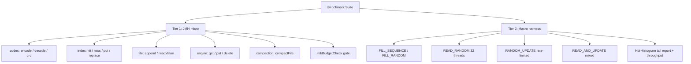

# halo-next Benchmark Plan

> Status: Draft. Source of truth for benchmark scope. Pairs with ADR-0003
> (perf baseline). Any hot-path number published here must respect the
> Performance Budget in `.github/copilot-instructions.md`.

## 1. Goal

Establish a two-tier benchmark suite that:

1. Protects the hot-path latency budget per operation (micro, JMH).
2. Reproduces the original HaloDB macro workloads (fill, read, update,
   read-while-write) to validate end-to-end throughput, tail latency, read
   amplification = 1, and write amplification ~ 1 / compactionThreshold at
   dataset scale.

Reference: `tmp/HaloDB/benchmarks` (custom harness) and
`tmp/HaloDB/docs/benchmarks.md` (methodology, 500M x 1KB, 32 read threads,
HdrHistogram tail percentiles).

## 2. Current State

Existing JMH micro-benchmarks in `src/jmh/java/io/justrade/halonext`:

| Benchmark | File | Measures | Budget |
|-----------|------|----------|--------|
| `decodeHeader` / `decodeAndVerify` | `buffer/RecordDecodeBenchmark.java` | flyweight wrap + read, CRC verify | < 100 ns |
| `lookupHit` | `index/IndexLookupBenchmark.java` | off-heap index hit | < 200 ns |
| `get` / `put` | `core/EngineBenchmark.java` | end-to-end warm get, buffered put | < 10 us / < 5 us |

Infrastructure already in place:

- JMH plugin 0.7.2, JMH 1.37, JSON result output to `build/results/jmh/results.json`.
- `-PquickBench` fast smoke gate (1 warmup, 1 iter, 1 fork).
- `jmhBudgetCheck` task fails the build on absolute budget breach (ADR-0003).
- `-Pjmh.profilers=gc` wiring for allocation profiling.
- HdrHistogram declared as a dependency (currently unused in benchmarks).

### Gaps vs HaloDB

- No `delete` / tombstone-path micro-benchmark.
- No `encodeRecord` / index-entry / tombstone codec write benchmarks.
- No index-miss, `putIfAbsent`, or `replace` (compaction) index benchmarks.
- No `append` (data file sequential write) or `readValue` (random read) file-layer benchmark.
- No compaction throughput / `compactFile` benchmark.
- No macro harness: no multi-thread read throughput, no tail-latency report,
  no fill/update/read-while-write workloads, no dataset-scale (IO-bound) runs.
- HdrHistogram present but not wired to any latency report.

## 3. Benchmark Tiers



### Tier 1: JMH micro-benchmarks (hot-path budget guard)

Purpose: per-operation latency and zero-allocation verification. Steady-state
allocation-free (verified with `-prof gc`). Each new budgeted benchmark is
added to the `jmhBudgetCheck` map and ADR-0003 table.

New benchmarks to add (one `@State(Scope.Thread)` class per package, matching
existing style - temp dir in `@Setup(Level.Trial)`, cleanup in `@TearDown`,
cursor rotation to avoid dead-code elimination, `Mode.AverageTime`):

| Package | Benchmark | Target | Budget (proposed) |
|---------|-----------|--------|-------------------|
| `buffer` | `encodeRecord` (wrap + write header + storeChecksum) | `RecordFlyweight` | < 100 ns |
| `buffer` | `encodeIndexEntry`, `encodeTombstone` | index/tombstone flyweights | < 100 ns |
| `index` | `lookupMiss` (absent key) | `OffHeapIndex.get` | < 200 ns |
| `index` | `insert` (put into presized table) | `OffHeapIndex.put` | < 300 ns |
| `index` | `replace` (compaction CAS path) | `OffHeapIndex.replace` | < 300 ns |
| `file` | `append` (sequential write, buffered) | `DataFile` append | < 1 us |
| `file` | `readValue` (random read, warm page cache) | `DataFile` read | < 10 us |
| `core` | `delete` (tombstone append + index remove) | `HaloEngine.delete` | < 5 us |
| `core` | `getMiss` (index miss, no disk read) | `HaloEngine.get` | < 1 us |
| `compaction` | `compactFile` (migrate live records) | compaction agent | throughput, no budget gate |

Variants (JMH `@Param`): value size `{128, 1024, 4096}`, key size `{8, 16, 64}`,
`syncWrite {false, true}` for write-path benchmarks.

### Tier 2: Macro workload harness (end-to-end, dataset scale)

Purpose: reproduce HaloDB `BenchmarkTool` workloads to measure throughput, tail
latency, DB size, and amplification. This is a cold-path driver (allocation
inside the harness is acceptable); only the engine under test must stay on
budget. Latency is captured with HdrHistogram (nanos), reported as
p50 / p90 / p99 / p99.9 / p99.99 / max per the telemetry rule.

Workloads mapped 1:1 from HaloDB:

| Workload | HaloDB equivalent | Driver | Metric |
|----------|-------------------|--------|--------|
| `FILL_SEQUENCE` | sequential 8-byte keys 0..N | single writer | put throughput, DB size |
| `FILL_RANDOM` | random key order | single writer | put throughput, DB size |
| `READ_RANDOM` | 32 reader threads, random keys | multi-reader | read tail latency, ops/sec |
| `RANDOM_UPDATE` | rate-limited random updates | single writer + limiter | update throughput, final size, write amp |
| `READ_AND_UPDATE` | 32 readers + 1 writer concurrent | mixed | read tail under write load, write throughput |

Harness design:

- Options mirror HaloDB defaults: `maxFileSize = 1 GiB`,
  `compactionThresholdPerFile = 0.50`, `flushDataSizeBytes = 10 MiB`,
  `numberOfRecords = 2 * N` (2x sizing), `compactionJobRate = 135 MiB/s`,
  `useMemoryPool = true`, `fixedKeySize = 8`.
- Value payload from a preseeded reusable buffer (cycle through a fixed
  `byte[]`) to avoid per-op allocation in the driver, mirroring HaloDB
  `RandomDataGenerator`.
- Writer uses a rate limiter for update workloads (Agrona idle strategy or a
  token bucket; avoid Guava).
- Reader threads record `System.nanoTime()` deltas into per-thread
  `Histogram`, aggregated at the end (HdrHistogram supports add across
  threads).
- Report block: per-workload JSON + human summary (throughput, tail
  percentiles, DB bytes on disk, measured read amplification, estimated write
  amplification from bytes written vs logical bytes).

## 4. Dataset Tiers (scaled)

The original 500 GB (500M x 1KB, 4x RAM) run is a release-grade, dedicated-host
benchmark. Define tiers so the suite runs on a laptop in CI and scales up on a
benchmark host.

| Tier | Records | Value | Approx size | Use |
|------|---------|-------|-------------|-----|
| `smoke` | 100 K | 1 KB | ~100 MB | CI gate, fits page cache |
| `small` | 5 M | 1 KB | ~5 GB | local dev, partially IO-bound |
| `medium` | 50 M | 1 KB | ~50 GB | benchmark host, IO-bound |
| `release` | 500 M | 1 KB | ~500 GB | dedicated host, matches HaloDB paper |

Tier selected via a gradle property, e.g. `-Pworkload=smoke`. Read-ahead
disabled for read tiers to measure true random-read amplification (document the
`blockdev`/mount note in the run README, not enforced by code).

## 5. Metrics and Reporting

Per the telemetry rules:

- Latency: HdrHistogram, report p50 / p90 / p99 / p99.9 / p99.99 / max. Tail is
  the contract, not the mean.
- Throughput: ops/sec and MB/sec for writes; ops/sec for reads.
- Allocation: JMH `-prof gc` (`-Pjmh.profilers=gc`) must show ~0 B/op steady
  state for every budgeted hot-path benchmark.
- Read amplification: assert 1 disk read per `get` (instrument file-layer read
  counter in the harness, compare to op count).
- Write amplification: bytes physically written / logical bytes, expect
  ~ 1 / compactionThreshold (~2 at 0.50). Published in the update workloads.
- DB size: on-disk bytes after fill and after update (compare to HaloDB:
  503 GB fill, 556 GB after update).

Output format: JMH JSON for Tier 1 (existing pipeline); a structured JSON + a
markdown summary table for Tier 2, written under `build/results/benchmark/`.

## 6. Build and CI Integration

- Tier 1 stays in the `jmh` source set. New budgets added to the
  `jmhBudgetCheck` map in `build.gradle.kts` and to the ADR-0003 baseline table.
- CI step 5 unchanged: `./gradlew jmh -PquickBench` + `jmhBudgetCheck` smoke,
  fail on > 10% regression vs ADR-0003 baseline.
- Tier 2 macro harness: a runnable entry point driven by a gradle task
  (`benchmarkRun -Pworkload=smoke -Pbench=READ_RANDOM`). Not part of the
  per-commit gate; run on demand and on the benchmark host. The `smoke` tier of
  `FILL_SEQUENCE` + `READ_RANDOM` can be added as a nightly job.
- Any regression > 10% on any percentile requires rollback or a new ADR, per
  the performance budget.

## 7. Implementation Phases

1. Phase 1 - Tier 1 completeness
   - Add codec write benchmarks (`encodeRecord`, index entry, tombstone).
   - Add index `lookupMiss`, `insert`, `replace`.
   - Add `core` `delete`, `getMiss`.
   - Wire new budgets into `jmhBudgetCheck` and ADR-0003 table.
   - Verify zero-alloc with `-Pjmh.profilers=gc`.
   - Status: DONE. All benchmarks pass the budget gate and are allocation-free
     (except `get`, which inherently returns a `byte[]`). See ADR-0003.

2. Phase 2 - File-layer benchmarks
   - Add `file` `append` and `readValue` benchmarks (warm and cold variants).

3. Phase 3 - Macro harness skeleton
   - Preseeded data generator, HdrHistogram reporter, rate limiter, options
     presets, dataset tiers, JSON + markdown output.
   - Implement `FILL_SEQUENCE` and `FILL_RANDOM`.

4. Phase 4 - Read and mixed workloads
   - Implement `READ_RANDOM` (32 threads), `RANDOM_UPDATE`, `READ_AND_UPDATE`.
   - Add read-amplification and write-amplification instrumentation.

5. Phase 5 - Compaction and soak
   - `compactFile` throughput benchmark.
   - Long-running soak at `small`/`medium` tier with allocation profiler
     attached, asserting zero steady-state GC during the operational window.

6. Phase 6 - Baseline capture and ADR
   - Run `medium` tier on the benchmark host, record numbers, update ADR-0003
     (or a new ADR) with macro baselines and the regression threshold.

## 8. Open Questions

- Rate limiter: Agrona-native token bucket vs a minimal custom limiter (avoid
  Guava, which was the HaloDB dependency being removed).
- Macro harness location: extend the `jmh` source set vs a dedicated
  `benchmark` source set / runnable main. Leaning toward a dedicated source set
  so the driver can allocate freely without polluting hot-path lint rules.
- Whether to vendor a RocksDB comparison (HaloDB benchmarked against RocksDB and
  KyotoCabinet). Proposed: out of scope for v1, revisit after internal baselines
  are stable.
```