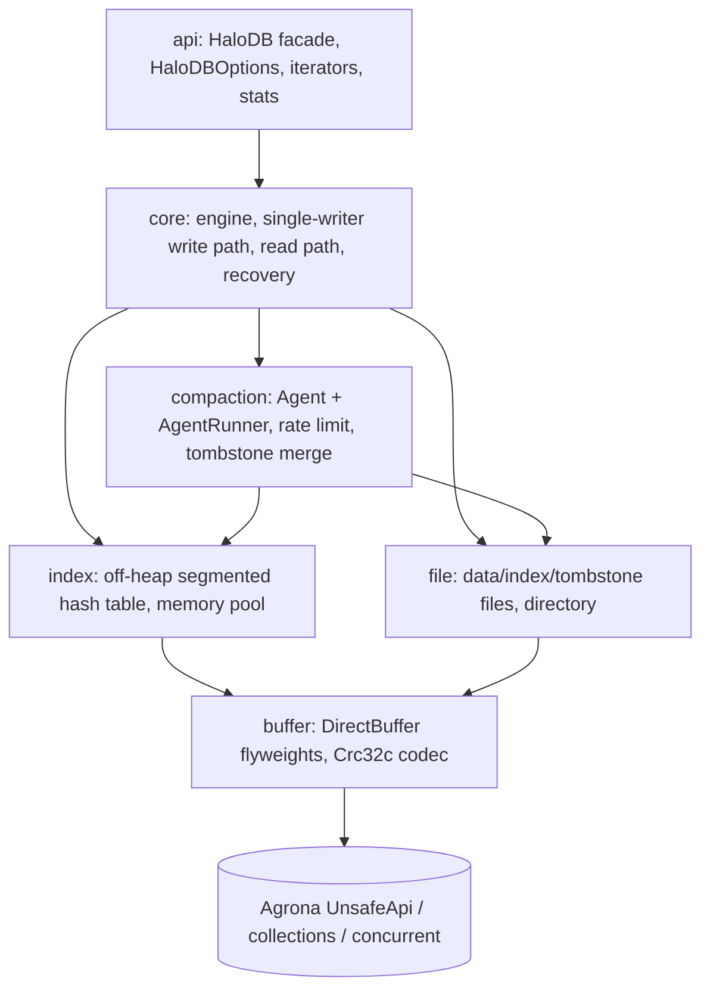
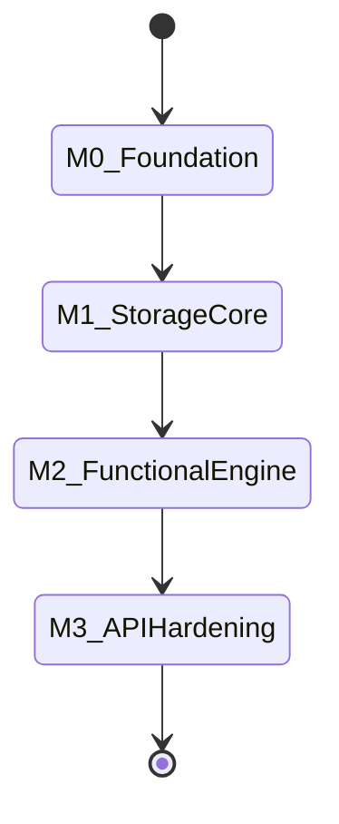

# halo-next Port Plan

Status: Draft
Owner: halo-next
Last updated: 2026-11-08
Source of truth for architectural decisions: `/docs/decisions`

## 1. Goal

Port HaloDB (an embedded, append-only, log-structured key-value store originally
written for Java 8 using JNA, Guava, and `sun.misc.Unsafe`) into a modern JDK 21
engine named halo-next, rebuilt on the Agrona framework. The port preserves
HaloDB's core design guarantees while modernizing its runtime, build, and
concurrency primitives, and aligning the codebase with the allocation-conscious,
single-writer, lock-free conventions in `.github/copilot-instructions.md`.

### Core guarantees to preserve

- Read amplification = 1 (single disk read per `get`).
- Append-only sequential writes; immutable rolled data files.
- Off-heap in-memory index (all keys + metadata) to minimize GC pressure.
- Single-writer, multi-reader concurrency with sequence-number versioning.
- Threshold-based, rate-limited compaction with write amplification `~1/x`.
- Crash recovery by replaying index / tombstone files.

### Non-goals (initial release)

- Changing the on-disk format (kept binary-compatible unless an ADR bumps the
  format version).
- Range scans / ordered iteration beyond HaloDB's existing forward iterators.
- Distributed replication / clustering (future consideration).

## 2. Source Analysis Summary

### 2.1 HaloDB components (`tmp/HaloDB`)

| Area | Key classes | Notes |
|------|-------------|-------|
| Public API | `HaloDB`, `HaloDBOptions`, `HaloDBIterator`, `HaloDBKeyIterator`, `HaloDBStats` | Facade, config, iteration, stats |
| Core engine | `HaloDBInternal`, `Record`, `DBMetaData`, `DBDirectory` | Lifecycle, write / read / delete, recovery |
| Files | `HaloDBFile`, `IndexFile`, `IndexFileEntry`, `TombstoneFile`, `TombstoneEntry` | Append log + index + tombstones |
| Off-heap index | `InMemoryIndex`, `OffHeapHashTableImpl`, `Segment`, `SegmentWithMemoryPool`, `SegmentNonMemoryPool`, `InMemoryIndexMetaData` | Segmented off-heap hash table |
| Memory pool | `MemoryPoolChunk`, `MemoryPoolAddress`, `MemoryPoolHashEntries` | Fixed-slot allocation |
| Native memory | `NativeMemoryAllocator`, `UnsafeAllocator`, `Uns`, `UnsExt` | JNA / Unsafe off-heap access |
| Compaction | `CompactionManager`, Guava `RateLimiter`, `BlockingQueue` | Background compaction thread |
| Checksums / histo | `Record` CRC32, `histo/EstimatedHistogram` | Corruption detection, stats |

Legacy dependencies: SLF4J 1.7, Guava 18, JNA 4.1, optional LZ4 1.3; TestNG +
JMockit + AssertJ; Maven build; Java 8.

### 2.2 Agrona components to adopt (`tmp/agrona`, v2.7.0, JDK 17+)

| HaloDB legacy | Agrona replacement | Benefit |
|---------------|--------------------|---------|
| JNA / `Uns` / `UnsafeAllocator` | `UnsafeBuffer`, `BufferUtil`, `UnsafeApi` | Supported off-heap access, no JNA |
| `Record` / entry byte juggling | `DirectBuffer` / `MutableDirectBuffer` flyweights | Zero-copy, stateless codecs |
| Manual CRC32 | `Crc32c` (hardware accelerated) | Faster checksum |
| `CompactionManager` thread | `Agent` + `AgentRunner` + `IdleStrategy` | Structured single-thread event loop |
| `BlockingQueue` compaction queue | `ManyToOneRingBuffer` / `OneToOneConcurrentArrayQueue` | Lock-free, bounded |
| Guava `RateLimiter` | Custom token-bucket or Agrona timing | Drop Guava |
| `staleDataPerFileMap` (`ConcurrentHashMap`) | `Int2IntHashMap` / `Int2ObjectHashMap` | No boxing |
| SLF4J hot-path logging | `DistinctErrorLog` + `AtomicCounter` | Off-heap, lock-free telemetry |
| Ad-hoc clock calls | `EpochClock` / `CachedEpochClock` | Cached, injectable, testable |
| Guava primitives / `Ints` | Agrona `BitUtil`, JDK | Fewer deps |

### 2.3 Convention alignment (`ledgerd` copilot-instructions)

Adopt: Gradle + JDK 21, spotless, checkstyle, `-Werror`, JMH; single-writer /
lock-free hot path; primitive collections only; flyweights over POJOs; off-heap
counters; Mermaid diagrams, ASCII only; `/docs/decisions` as source of truth;
local-only git. Full ruleset captured in `.github/copilot-instructions.md`.

## 3. Target Architecture

Proposed package root: `io.halonext` (final name decided in Sprint 0 ADR).
Module layout: `buffer`, `index`, `file`, `core`, `compaction`, `api`, `config`,
`util`, plus `src/test` and `src/jmh`.

## 4. Milestones

| Milestone | Theme | Sprints | Exit criteria |
|-----------|-------|---------|---------------|
| M0 Foundation | Build, scaffolding, codec | S0, S1 | Gradle + CI green, flyweight codecs round-trip with CRC32C |
| M1 Storage core | Off-heap index + file layer | S2, S3 | Index put/get/delete + file append/read pass unit + property tests |
| M2 Functional engine | Write/read/delete path + compaction | S4, S5 | Full open/put/get/delete/reopen cycle; compaction reclaims space |
| M3 API + hardening | Public API, recovery, perf | S6, S7, S8 | Feature parity with HaloDB, crash-recovery + replay pass, perf budget met, GA |

## 5. Sprints

Each sprint ends with: spotless + checkstyle + `-Werror` clean, tests green, and
(from S4 on) JMH smoke run with no >10% regression. Any format or API decision is
recorded as an ADR under `/docs/decisions`.

### Sprint 0 - Project scaffolding (M0)

Goal: a buildable, lintable empty project matching the conventions.

- Convert build to Gradle multi-task (`build`, `test`, `integrationTest`, `jmh`)
  on the JDK 21 toolchain; add Agrona + HdrHistogram dependencies.
- Configure spotless, checkstyle (port `tmp/agrona/config/checkstyle`), `-Werror`.
- Create package skeleton (`buffer`, `index`, `file`, `core`, `compaction`,
  `api`, `config`, `util`) and `src/jmh`.
- Add `.github/copilot-instructions.md` (done), `/docs/decisions` ADR template,
  `NOTICE` with HaloDB (Oath) + Agrona attribution, Apache 2.0 `LICENSE`.
- ADR-0001: final package name and module boundaries.
- ADR-0002: keep on-disk format binary-compatible with HaloDB 0.5.x.

Deliverables: green `./gradlew build` on an empty skeleton; CI pipeline.

### Sprint 1 - Buffer and codec layer (M0)

Goal: zero-copy flyweight codecs for every on-disk structure.

- `RecordFlyweight` (18-byte header: crc32, version, keySize, valueSize,
  sequenceNumber) over `MutableDirectBuffer`.
- `IndexEntryFlyweight` (22-byte header), `TombstoneEntryFlyweight` (14-byte
  header), `DbMetaDataFlyweight` (20 bytes) with open / io-error flags.
- `Crc32c`-based checksum helper computing / verifying over buffer regions.
- Little-endian enforced; field offsets locked as the format contract.

Deliverables: round-trip + CRC property tests (jqwik); JMH decode benchmark
scaffold.

### Sprint 2 - Off-heap in-memory index (M1)

Goal: port the segmented off-heap hash table onto Agrona primitives.

- `NativeAllocator` on Agrona `UnsafeApi` / `BufferUtil.allocateDirectAligned`
  (replaces JNA `Uns` / `UnsafeAllocator`).
- `OffHeapIndex` with power-of-two segment count (>= 2x CPUs), per-segment
  spin-lock, `IndexMetaData` (fileId, valueOffset, valueSize, sequenceNumber).
- Non-pool segment strategy first (rehash on load factor); then fixed-slot
  memory-pool strategy (`useMemoryPool` + `fixedKeySize`, chunked slots).
- `setNumberOfRecords` preallocation path.

Deliverables: put/get/delete/replace concurrency tests; load / rehash tests;
JMH lookup benchmark (budget < 200 ns hit).

Note: the non-pool segment strategy is implemented. The fixed-slot memory-pool
strategy (`useMemoryPool` + `fixedKeySize`) is deferred to a follow-up task
tracked under M2 hardening; it is a predictable-memory optimization and not
required for functional correctness.

### Sprint 3 - File and directory layer (M1)

Goal: append log, index, tombstone, and directory management.

- `DataFile` (append + random read via flyweight), `IndexFile` (append index
  entries), `TombstoneFile` (append tombstones), with roll-over at `maxFileSize`
  / `maxTombstoneFileSize`.
- `DbDirectory` for file discovery, naming (`<id>.data/.index/.tombstone`,
  `.datac`, `META`), and repair-temp handling.
- Flush policy honoring `flushDataSizeBytes` and `syncWrite`.

Deliverables: file round-trip + roll-over tests; corruption / partial-write
detection tests via CRC.

### Sprint 4 - Core engine (write / read / delete) (M2)

Goal: a working single-writer engine without compaction.

- `HaloEngine`: single-writer `put` (append data + index, update off-heap index,
  assign sequence number), `get` (index lookup + one disk read), `delete`
  (append tombstone + remove from index).
- Open / recovery: rebuild index from index + tombstone files; parallel rebuild
  bounded by `buildIndexThreads` (cold path only); `META` dirty-open detection.
- Durability contract per `syncWrite` / `flushDataSizeBytes`.

Deliverables: open/put/get/delete/reopen integration tests; crash-recovery test
(dirty shutdown -> correct reads); JMH put/get budget check.

### Sprint 5 - Compaction as an Agrona Agent (M2)

Goal: reclaim stale space without hurting foreground latency.

- `CompactionAgent` (`Agent` + `AgentRunner` + `BackoffIdleStrategy`) consuming a
  `ManyToOneRingBuffer` / `OneToOneConcurrentArrayQueue` of file ids.
- Stale tracking with `Int2IntHashMap`; trigger at `compactionThresholdPerFile`;
  rate-limit to `compactionJobRate` (token bucket replacing Guava `RateLimiter`).
- Out-of-place rewrite of live records to new files; index update; old-file
  deletion; `pauseCompaction` / `resumeCompaction`.
- Optional tombstone-merge agent for open-time cleanup
  (`cleanUpTombstonesDuringOpen`).

Deliverables: compaction correctness tests (no lost / resurrected keys); write-
amplification assertion `~1/threshold`; soak test with allocation profiler.

Note: the compaction path allocates a key/value array per migrated record. This
is the rate-limited background path, not the foreground hot path. An allocation-
free compaction (off-heap key lookup so migration copies buffer-to-buffer) is a
documented follow-up tracked under M2 hardening.

### Sprint 6 - Public API, iterators, stats, snapshot (M3)

Goal: feature parity surface.

- `HaloDB` facade (`open`, `get`, `put`, `delete`, `close`, `size`,
  `pauseCompaction`, `resumeCompaction`, `snapshot`, `clearSnapshot`).
- `HaloDBOptions` with all tuning knobs (file sizes, thresholds, pool, threads,
  sync, flush, cleanup flags).
- `HaloDBIterator` / `HaloDBKeyIterator`; `HaloDBStats` backed by Agrona
  `AtomicCounter` + HdrHistogram; `resetStats`.

Deliverables: API parity tests ported from HaloDB's TestNG suite (migrated to
JUnit 5); iterator correctness under concurrent writes.

### Sprint 7 - Testing, benchmarks, perf validation (M3)

Goal: prove correctness and the performance budget.

- Property tests (codec, sequence arithmetic, index invariants); deterministic
  replay tests (recorded ops in == rebuilt state out, byte-identical index).
- Full JMH suite: codec, index lookup, write path, compaction, end-to-end
  get/put; publish baseline numbers in `/docs/decisions/perf-baseline.md`.
- Validate budget: get < 10 us, put < 5 us, lookup < 200 ns, decode < 100 ns,
  0 steady-state allocation (`-prof gc`), 0 GC in operational window (ZGC).

Deliverables: perf baseline ADR; CI quick-bench gate wired into step 5.

### Sprint 8 - Hardening, docs, release (M3 / GA)

Goal: ship a GA-quality 1.0.

- Soak / chaos: long-running mixed workload with compaction, assert zero
  steady-state GC and stable tail latency.
- Crash-injection matrix (kill during append / compaction / rebuild) -> recovery
  correctness.
- Documentation: architecture overview (Mermaid), tuning guide, migration notes
  from HaloDB; finalize `NOTICE` / `LICENSE`.
- Release ADR; tag `v1.0.0` locally (no remote push).

Deliverables: GA artifact, docs, signed-off ADRs.

## 6. Risks and Mitigations

| Risk | Impact | Mitigation |
|------|--------|-----------|
| On-disk format drift during port | Breaks compatibility | Lock offsets in Sprint 1; round-trip tests vs HaloDB fixtures; ADR-0002 |
| Off-heap index bugs (leaks / corruption) | Data loss, crashes | Bounds-check at boundary; `-fsanitize`-style stress tests; close-time leak assertions |
| Agrona `UnsafeApi` vs legacy `Unsafe` semantics | Subtle memory bugs | Centralize access in `NativeAllocator`; document ordering per `VarHandle` |
| Compaction starving foreground IO | Latency spikes | Rate limiter + idle strategy tuning; JMH end-to-end under compaction |
| Hidden allocation on hot path | GC pressure | JMH `-prof gc` gate in CI; flyweight reuse review |
| Test framework migration (TestNG -> JUnit 5) | Lost coverage | Port suite incrementally; keep behavior assertions identical |

## 7. Definition of Done (per change)

1. `./gradlew spotlessApply` clean.
2. `./gradlew checkstyleMain checkstyleTest` zero violations.
3. `./gradlew compileJava` zero warnings (`-Werror`).
4. `./gradlew test integrationTest` all green.
5. `./gradlew jmh -PquickBench` no regression > 10% vs baseline.
6. Architectural decisions recorded under `/docs/decisions`.
7. Local commit only; no remote push.
